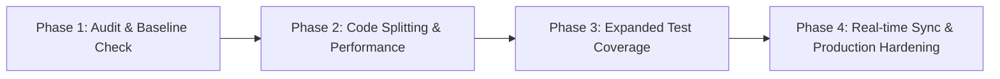

# ResQ AI Assistant — Project Plan & Progress Report

**Document Version:** 1.0.0  
**Status:** In Progress / Stable Development  
**Last Evaluated:** 2026-11-12  

---

## 1. Project Overview & Architecture

**ResQ AI Assistant** is a resilient, intelligent disaster management, risk prediction, and emergency coordination platform designed with offline-first capabilities, interactive geospatial mapping, and automated community response tools.

### Tech Stack
- **Frontend:** React 18, TypeScript, Vite, Tailwind CSS, Lucide Icons, Shadcn UI / Radix primitives.
- **Mapping & Geospatial:** Leaflet, React-Leaflet, Leaflet Routing Machine, OpenStreetMap tiles, NASA FIRMS active fire hotspots.
- **Backend & Database:** Supabase (Auth, Postgres, Realtime Subscriptions, Edge Functions, Row-Level Security).
- **AI & Forecasting:** Supabase Edge Functions integrating Gemini API (`resqai-chat`, `predict-risk`), local heuristic / offline risk prediction fallback engine.
- **Offline / PWA:** Vite PWA (`vite-plugin-pwa`), Service Workers, IndexedDB/LocalStorage resilience for mesh & offline reporting.
- **Testing & Code Quality:** Vitest, ESLint, TypeScript Compiler (`tsc`).

---

## 2. Current Implementation Progress Status

| Module / Feature Area | Description | Implementation Status | Health / Verification |
| :--- | :--- | :---: | :--- |
| **Project Setup & Build** | Vite build, TypeScript types, PWA generation | Completed | `tsc --noEmit` & `npm run build` pass (0 errors) |
| **Interactive Map & GIS** | Disaster overlays, active events, NASA FIRMS fire markers, safe zones, routing, CARTO basemap API key | Completed | Operational (CARTO basemap authenticated) |
| **AI Assistant / Chat** | AI Chat panel (`resqai-chat` Edge Function + Gemini API fallback) | Completed | Configured & operational |
| **Risk Prediction Engine** | AI-driven and offline prediction calculations (`OfflinePredictionEngine.tsx`) | Completed | Operational |
| **Emergency SOS & Reporting** | SOS trigger, incident report submission form, community validation | Completed | Operational |
| **Evacuation Planning** | Route computation, shelter finder, evacuation zones, notification broadcasting | Completed | Operational |
| **Control Room / Ops Center** | Situational awareness dashboard, live alert banners, active event filters | Completed | Operational |
| **Resource Inventory** | Real-time supply tracking, logistical assets, allocation management | Completed | Operational |
| **Post-Disaster Recovery** | Damage assessments, rehabilitation tracking, recovery timeline & analytics | Completed | Operational |
| **Training & Drills** | Community drill planner, emergency training notifications, drill analytics | Completed | Operational |
| **Authentication & RBAC** | Supabase Auth login/signup, role-based controls (Citizen vs Admin / First Responder) | Completed | Operational |
| **Internationalization (i18n)** | Multilingual toggle and localization strings | Completed | Integrated |
| **Automated Testing Suite** | Unit and integration test coverage | Partial | Basic Vitest test present, needs extended coverage |

---

## 3. Milestones & Action Roadmap

### Phase 1: Environment & Baseline Verification (Completed)
- [x] Configure `.env` from template.
- [x] Verify TypeScript strict type-checking (`tsc --noEmit`).
- [x] Verify Vite build and Service Worker generation.
- [x] Verify development server execution (`http://localhost:8081`).

### Phase 2: Performance & Bundle Optimization (Next Priority)
- [ ] **Code Splitting / Dynamic Imports**: The bundle currently yields a `2.3 MB` main JS chunk. Implement React `lazy` and `Suspense` for heavy routes (`ControlRoom`, `ForecastCenter`, `ResourceInventory`, `PostDisaster`, `TrainingDashboard`).
- [ ] **Leaflet Bundle Separation**: Separate Leaflet and heavy chart dependencies into dedicated vendor chunks in `vite.config.ts`.
- [ ] **PWA Cache Strategy**: Optimize precache configuration for offline map tiles and static assets.

### Phase 3: Testing & Resilience (In Progress)
- [ ] **Component Unit Tests**: Add test suites for core interactive components (`SOSButton`, `ReportForm`, `ShelterFinder`, `OfflinePredictionEngine`).
- [ ] **Edge Function Mock Tests**: Test fallback paths when Gemini API or external NASA FIRMS endpoints are unreachable or unconfigured.
- [ ] **Mesh / Offline Sync Testing**: Validate offline incident caching and sync reconciliation upon network recovery.

### Phase 4: Production Deployment & Live Infrastructure
- [ ] Deploy Edge Functions to live Supabase project instance (`predict-risk`, `fetch-disasters`, `resqai-chat`).
- [ ] Verify Supabase Row Level Security (RLS) policies against authenticated vs anonymous user roles.
- [ ] Configure live NASA FIRMS API key and Gemini API key secrets in production.
