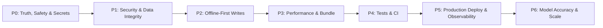

# ResQAI — Master Plan, Audit & Progress Tracker

**Document version:** 2.0.0  
**Audit date:** 2026-11-12  
**Baseline commit:** `6c93bb7` (`main`)  
**Scope:** `C:\Users\Dev\Desktop\resq-ai-assistant`  
**Status:** Foundation built; production hardening not complete

> This document replaces the previous optimistic status report. Every status below is backed by a command, a file reference, or a runtime check. Anything not verified is marked **Unverified** rather than “Completed”.

---

## 0. Executive Summary

ResQAI is a substantial React + Supabase disaster-intelligence prototype. The core screens, map, authentication, community reporting, prediction UI, and several operational dashboards exist and build successfully. The project is **not yet production-ready**: several screens present synthetic data as live data, predictions do not consume live weather features, there is no offline write path for SOS/reports, and there is effectively no automated test or CI coverage.

### Scorecard

| Dimension | Score | Verdict |
| :--- | :---: | :--- |
| Feature breadth | **85 / 100** | Broad, working prototype across most planned modules |
| Data integrity & trust | **45 / 100** | Real feeds exist, but synthetic data is mixed into operational views |
| Security & access control | **55 / 100** | RLS exists on most tables; one open insert policy and public edge functions remain |
| Performance | **30 / 100** | Single `2.35 MB` JS chunk; no route splitting |
| Offline resilience | **40 / 100** | App shell and predictions cache; no offline write queue; mesh is simulated |
| Automated testing | **5 / 100** | One trivial assertion; no meaningful coverage |
| Documentation accuracy | **50 / 100** | README is detailed but overclaims several implemented features |
| Production readiness | **35 / 100** | No CI, no deployment config, no observability, secrets in git history |

**Overall production-readiness estimate: ~48 / 100.**

### Top risks, in order

1. **Trust risk — synthetic data looks live.** Admin counts, mesh peer counts, and evacuation summaries use hardcoded or random values.
2. **Model credibility — live weather is not wired into predictions.** `predict-risk` accepts weather features, but the client sends only coordinates.
3. **Secret exposure — `.env` exists in git history.** Any credential ever committed must be rotated.
4. **Safety risk — no offline write queue.** SOS and incident reports fail when connectivity is lost, which is the core use case.
5. **Performance risk — one large bundle.** `2.35 MB` JS (575 kB gzip) and a `2.65 MB` PWA precache close to the `3 MB` cap.
6. **Regression risk — no tests and no CI.** Only `src/test/example.test.ts` exists.
7. **Cost/abuse risk — public edge functions.** `fetch-disasters` and `predict-risk` have `verify_jwt = false` and no rate limiting.
8. **Data-integrity risk — open `evac_notifications` insert policy.** `WITH CHECK (true)` allows anonymous spam.
9. **Documentation drift.** README claims chat history persistence, photo uploads, and Gemini integration that the code does not implement.
10. **Operational blindness.** No error tracking, uptime checks, or structured edge-function logging.

---

## 1. Architecture As Built

```
React 18 + TypeScript + Vite 7 + Tailwind + shadcn/Radix
  ├─ Leaflet + leaflet-routing-machine + CARTO tiles + OSRM
  ├─ TanStack Query + Supabase JS + Realtime
  ├─ i18next (en / hi / or)
  └─ vite-plugin-pwa (generateSW)

Supabase
  ├─ Auth (email/password)
  ├─ PostgreSQL + RLS
  ├─ Realtime (alerts, reports, shelters, validations, incidents, trainings, damage)
  └─ Edge Functions (Deno)
       ├─ predict-risk     → heuristics, optional ML_MODEL_URL
       ├─ fetch-disasters  → USGS + NASA EONET + Open-Meteo
       └─ resqai-chat      → Lovable AI gateway (Gemini model), auth-gated

External
  USGS · NASA EONET · NASA FIRMS · Open-Meteo (weather/air/marine)
  OSRM · CARTO · Lovable AI Gateway · optional ML_MODEL_URL
```

### Actual prediction data flow

```
15 hardcoded Odisha grid points
        ↓
useGridPredictions() → predict-risk edge function
        ↓  (only latitude, longitude, label are sent)
Season + geography heuristics
        ↓
risk scores + confidence 0.65 + rule-based explainability
        ↓
PredictionPanel / DisasterMap heatmap
        ↓
OfflinePredictionEngine caches simplified results in localStorage
```

**Important:** the weather block in `predict-risk` is dead code in the normal client path because `features` is never supplied by `useGridPredictions`. The README describes weather-aware prediction, but the live path is season/geography-only.

### Route inventory

| Route | Page | Status |
| :--- | :--- | :--- |
| `/` | `Index.tsx` | Landing page |
| `/dashboard` | `Dashboard.tsx` | Map + side panels + chat + SOS |
| `/forecast` | `ForecastCenter.tsx` | Forecast, fire demo mode, charts |
| `/control-room` | `ControlRoom.tsx` | Incidents + resources coordination |
| `/evacuate` | `EvacuationPlanner.tsx` | Shelters + routing |
| `/resources` | `ResourceInventory.tsx` | Resource CRUD |
| `/training` | `TrainingDashboard.tsx` | Training CRUD + analytics |
| `/post-disaster` | `PostDisaster.tsx` | Damage assessments + recovery |
| `/admin` | `Admin.tsx` | Client-side admin gate + dashboard |
| `/auth` | `Auth.tsx` | Sign in / sign up |
| `*` | `NotFound.tsx` | 404 |

---

## 2. Verified Baseline

Commands run against the baseline commit on 2026-11-12.

| Gate | Command | Result | Status |
| :--- | :--- | :--- | :---: |
| TypeScript | `npx tsc --noEmit -p tsconfig.app.json` | 0 errors | **Pass** |
| ESLint | `npm run lint` | 0 errors, **69 warnings** | **Pass with debt** |
| Tests | `npm test` | 1 file, 1 test, trivial assertion | **Fail (coverage)** |
| Build | `npm run build` | 3,042 modules, built in 19.51 s | **Pass** |
| Main JS | build output | `dist/assets/index-*.js` = **2,348.08 kB** (575.54 kB gzip) | **Fail (budget)** |
| CSS | build output | `99.79 kB` (23.69 kB gzip) | Pass |
| PWA precache | build output | **11 entries, 2,654.54 KiB** | Pass, near 3 MB cap |
| Dev server | `npm run dev` | Vite ready in 548 ms; `http://127.0.0.1:8080/` returns HTTP 200 | **Pass** |
| CI | repository | No `.github/workflows` | **Missing** |
| Deployment | repository | No Vercel/Netlify/Cloudflare config | **Missing** |

### Quality observations

- `tsconfig.app.json` has `strict: false`, `noImplicitAny: false`, and unused checks disabled.
- 69 ESLint warnings are mostly `@typescript-eslint/no-explicit-any` in hooks, pages, and edge functions.
- `src/test/example.test.ts` only asserts `true === true`.
- `src/test/setup.ts` provides `matchMedia` but no Supabase, Leaflet, or network mocks.
- No component, hook, RLS, or edge-function tests exist.
- Build emits a chunk-size warning; PWA precache is 2.65 MB against a 3 MB `maximumFileSizeToCacheInBytes`.

---

## 3. Feature Status Matrix

Legend: **Verified** = works and checked; **Implemented** = code exists, not fully verified; **Partial** = works with important gaps; **Prototype** = simulated or incomplete; **Missing** = not present.

| Area | What exists | Status | Evidence / gaps |
| :--- | :--- | :---: | :--- |
| Build & tooling | Vite 7, React 18, TypeScript, Tailwind, Vitest, ESLint | **Verified** | Build/typecheck/lint pass; tests are trivial |
| Authentication | Email/password sign-up/in/out, session persistence | **Implemented** | `src/contexts/AuthContext.tsx`; no password reset or email verification flow verified |
| Roles / RBAC | `citizen`, `responder`, `admin`; `has_role()` + RLS | **Partial** | RLS on core tables; `/admin` gate is client-side only; no RLS test suite |
| Interactive map | Leaflet, CARTO dark tiles, Odisha outline, shelter markers, reports, routes | **Implemented** | `src/components/DisasterMap.tsx`; boundary is a hardcoded polyline; CARTO has a public fallback key |
| Live disaster feeds | USGS earthquakes, NASA EONET, Open-Meteo weather/air/marine | **Implemented** | `supabase/functions/fetch-disasters/index.ts`; no auth/rate limit; failures silently return empty data |
| NASA FIRMS fire layer | Real API when key set; 4 hardcoded hotspots when missing | **Partial** | `src/hooks/useDisasterData.ts`; Forecast page labels “Demo mode”, other consumers may not |
| Prediction engine | 15-point grid, 6 risk types, heuristics, explainability, alert tiers | **Partial** | Live weather features not sent; confidence fixed at `0.65`; no persistence; no accuracy tracking |
| Prediction persistence | `risk_predictions` table + realtime listener | **Partial** | Client intentionally does not insert; no server-side cron/writer found |
| AI assistant | Streaming chat, auth gate, TTS, speech input, EN/HI/OR prompts | **Partial** | `AIChatPanel.tsx` + `resqai-chat/index.ts`; no `chat_history` use; no location sent; no per-user rate limit |
| Community validation | Confirm/deny votes, trust score trigger, realtime updates | **Implemented** | `CommunityValidation.tsx` + migration; author can vote on own report; no comment UI |
| Reporting | Authenticated reports with type, description, coordinates | **Partial** | `ReportForm.tsx`; no photo upload despite README; online-only |
| SOS | Creates an emergency report with GPS coordinates | **Partial** | `SOSButton.tsx`; requires auth and connectivity; no SMS/offline fallback |
| Evacuation planning | DB shelters, capacity, OSRM routing, checklist | **Partial** | `EvacuationPanel.tsx` uses DB; `EvacuationMap.tsx` and `ShelterFinder.tsx` summaries use hardcoded `odishaShelters` |
| Control room | Incident CRUD, status flow, logs, resources | **Implemented** | `ControlRoom.tsx`; no route-level role gate; any authenticated user can create incidents/resources per RLS |
| Resource inventory | Resource CRUD, filters, map, stats | **Implemented** | `ResourceInventory.tsx`; no pagination; write access limited to creator/admin |
| Post-disaster recovery | Damage assessments, analytics, timeline, recovery phases | **Implemented** | `PostDisaster.tsx` + components; no photo storage; any authenticated user can create |
| Training dashboard | Training CRUD, institutions, themes, analytics, map | **Implemented** | `useTrainings.ts`; page text largely English-only |
| Internationalization | `i18next`, EN/HI/OR locales | **Partial** | EN 291 keys, HI/OR 290; `nav.postDisaster` missing in both |
| Alerts | Realtime banner, severity styles, optional Web Audio tone | **Implemented** | `AlertBanner.tsx`; requires authenticated read policy |
| PWA / offline shell | Service worker, manifest, runtime caches, update mode | **Implemented** | `vite.config.ts`; 11 precache entries; no tile prefetch or offline fallback page |
| Offline predictions | Cache latest grid in `localStorage`, show cached values offline | **Partial** | `OfflinePredictionEngine.tsx`; does not compute heuristics offline as its comment claims |
| Offline writes | Queue reports/SOS until reconnect | **Missing** | No queue, retry, or background sync found |
| Mesh networking | `BroadcastChannel` + random peer count | **Prototype** | `MeshAlertBanner.tsx` invents “mesh peers”; not real WebRTC/BLE |
| Tests | Vitest + Testing Library configured | **Missing (real coverage)** | One trivial test |
| CI/CD | None | **Missing** | No workflows, no deployment config |
| Observability | `console.error` only | **Missing** | No Sentry, metrics, uptime, or structured logs |
| Accessibility | Some ARIA labels and keyboard buttons | **Unverified** | No audit, no automated a11y checks |
| Documentation | Detailed README + this plan | **Partial** | Several claims not implemented; old plan had inaccurate “Completed” rows |

---

## 4. Contract & Documentation Discrepancies

These are concrete mismatches between what the project says and what it does.

| ID | Claim | Reality | Severity |
| :--- | :--- | :--- | :---: |
| D-01 | README/PLAN say Gemini API integration | `resqai-chat` uses `LOVABLE_API_KEY` and Lovable’s gateway with `google/gemini-3-flash-preview`; `.env` contains an unused `GEMINI_API_KEY` | High |
| D-02 | README says chat history is persisted per user | `chat_history` table exists, but `AIChatPanel.tsx` never reads or writes it | High |
| D-03 | README says predictions use 7-day precipitation, wind, max temperature, sea surface temperature | Client sends only `{ points: [{ latitude, longitude, label }] }`; `features` is `undefined`, so weather branches never run | Critical |
| D-04 | README says reports support an optional photo | `ReportForm.tsx` has no file input; `reports.photo_url` is never written | Medium |
| D-05 | Operational dashboards imply live counts | `Admin.tsx` uses `odishaDisasters`/`odishaShelters`; `EvacuationMap.tsx` uses hardcoded shelters; `MeshAlertBanner.tsx` randomizes peers | Critical |
| D-06 | Offline engine “runs lightweight heuristic predictions” | It only displays cached server results; no local heuristic computation | High |
| D-07 | Mesh networking is a feature | Peer count is `Math.random()`; only same-browser `BroadcastChannel` messaging exists | High |
| D-08 | README says the dev server runs on 8080 | Correct; the previous PLAN said 8081 | Low |
| D-09 | README says all tables use RLS | True, but `evac_notifications` allows anonymous inserts with `WITH CHECK (true)` | High |
| D-10 | README says the project is ready for contributors | No CI, no test coverage, no contribution checks beyond local commands | Medium |
| D-11 | `index.html` metadata | Still contains Lovable OG/Twitter metadata, a duplicate author tag, and an invalid `rel="upper-icon"` | Low |
| D-12 | Repository hygiene | `supabase/.temp/*` is tracked; `.env` was committed in earlier history (`832cf82`, `5825a74`, etc.) | Critical |

### Secret-history note

`git log --all -- .env` shows `.env` was tracked in earlier commits even though it is now ignored. Treat every credential that ever appeared in `.env` as compromised. Rotate the Supabase service-role key, any AI gateway key, NASA FIRMS key, and CARTO key before production. If the repository is or will be public, purge the history with `git filter-repo` or BFG and force-push after coordinating with contributors.

---

## 5. Prioritized Roadmap



### P0 — Truth, Safety & Secrets (highest priority)

**Goal:** no misleading operational data, no exposed credentials, and no silent failure of emergency actions.

- [~] **P0-01 — Rotate exposed credentials and clean repository history.** *(repo side done 2026-11-12; rotation blocked on owner)*
  - [ ] Rotate Supabase keys, Lovable AI key, NASA FIRMS key, CARTO key. **Owner action — see `SECURITY.md`.**
  - [x] Remove `supabase/.temp/` from git and add it to `.gitignore`.
  - [x] Decide whether to purge `.env` from history; document the decision in `SECURITY.md`. Decision: purge is deferred until contributors are notified; rotation is mandatory regardless.
  - [x] Remove unused `GEMINI_API_KEY` from `.env`; keep only variables the code reads. `.env.example` rewritten to client-only vars.
  - **Acceptance:** `git ls-files` contains no `.env`, no `supabase/.temp`; secret scan passes; production keys are new.
  - **Verified:** `git ls-files` shows no `.env` and no `supabase/.temp`; `.gitignore` covers `.env`, `.env.*`, `!.env.example`, `supabase/.temp/`. Key rotation still outstanding.

- [x] **P0-02 — Remove or clearly label synthetic operational data.** *(2026-11-12)*
  - [x] `MeshAlertBanner.tsx`: removed the random peer count; replaced with same-browser `BroadcastChannel` presence heartbeat labelled “local relay” / “local tabs”, with an explicit tooltip that it is not WebRTC/BLE.
  - [x] `Admin.tsx`: overview counts and the shelter table now query `incidents`, `shelters`, and `reports`; charts carry a “Charts use illustrative sample data” badge and the shelter table has an empty state.
  - [x] `EvacuationMap.tsx` and `ShelterFinder.tsx`: single live `shelters` source with realtime refresh; seed fallback only when the table is empty, marked with a “Seed shelter data” badge; duplicate hardcoded summaries removed.
  - [x] `LiveEventsPanel.tsx` / `ActiveEvents.tsx` / `RiskCards.tsx`: live events separated from sample events; sample rows and the regional outlook carry `DemoDataBadge`.
  - [ ] `ForecastCenter.tsx`: keep the existing “Demo mode” notice and make it visible anywhere mock hotspots appear. *(existing notice retained; broader coverage is a follow-up)*
  - **Acceptance:** no `Math.random()` in user-visible metrics; every synthetic dataset has a visible “Demo/Seed” badge; grep for `odishaDisasters`/`odishaShelters` in operational pages returns only intentional seed/demo uses.
  - **Verified:** `rg "Math\.random" src` finds one use, in the shadcn `ui/sidebar.tsx` skeleton width (a loading placeholder, not a metric); no displayed metric is randomized; all remaining `odishaData` imports are behind a `DemoDataBadge` or an empty-DB fallback.

- [ ] **P0-03 — Wire live weather features into `predict-risk`.**
  - In `useGridPredictions.ts`, assemble per-point features from `fetch-disasters` or Open-Meteo: `precipitation_7d`, `temperature_max`, `wind_speed_max`, `humidity`, `sea_surface_temp`.
  - Or make `predict-risk` fetch/cache weather server-side and accept only coordinates.
  - Add validation/clamping and return the features used in `explainability`.
  - **Acceptance:** a request with `precipitation_7d > 100` measurably raises `flood_risk`; response lists weather-derived factors; test covers both high-rain and dry cases.

- [ ] **P0-04 — Add an offline write queue for SOS and reports.**
  - New `src/lib/offlineQueue.ts` using IndexedDB (not `localStorage`).
  - On failure/offline, persist SOS/report payloads with `created_at`, retry count, and client-generated ID.
  - Flush on `online`, on app start, and from `OfflineIndicator`; show queued/synced/failed states.
  - Add idempotency key to avoid duplicate reports on retry.
  - **Acceptance:** submit SOS offline → app shows queued → reconnect → row appears exactly once in `reports`; tests cover retry and duplicate suppression.

- [ ] **P0-05 — Close RLS and abuse gaps.**
  - Replace `evac_notifications` `WITH CHECK (true)` with authenticated insert and `created_by = auth.uid()`; add `created_by` column and FK.
  - Add rate limiting/caching to `fetch-disasters` and `predict-risk`; consider requiring JWT for `fetch-disasters`.
  - Restrict `report_validations` so report authors cannot vote on their own reports.
  - Add `verify_jwt` review for all functions and document why each is public or protected.
  - **Acceptance:** anonymous insert into `evac_notifications` fails; author self-vote is rejected; repeated edge calls are throttled or cached.

- [ ] **P0-06 — Align the AI chat contract.**
  - Either persist conversations to `chat_history` (insert user message + assistant response) or remove the README claim.
  - Send optional consented `location` to `resqai-chat`; never send it silently.
  - Add per-user request throttling and a max message length.
  - **Acceptance:** signed-in user sees prior conversation after reload (if implemented) or README no longer claims persistence; location appears in prompt only after permission.

- [~] **P0-07 — Fix documentation and metadata drift.** *(i18n + metadata done 2026-11-12; README claims pending)*
  - [x] Add `nav.postDisaster` to `hi.json` and `or.json`; add a key-parity test. *(key added; parity test still P2)*
  - [x] Replace Lovable OG/Twitter metadata in `index.html` with ResQAI metadata; remove `rel="upper-icon"` and duplicate author tag.
  - [ ] Correct README claims about Gemini, photo upload, chat history, mesh, and offline heuristics.
  - **Acceptance:** locale key counts match; `index.html` has valid ResQAI social metadata; README statements match code.
  - **Verified:** `hi.json`/`or.json` now include `nav.postDisaster`; `index.html` has ResQAI OG/Twitter tags, one author tag, and no `upper-icon` link.

### P1 — Performance & Bundle

- [ ] **P1-01 — Route-level code splitting.**
  - Convert heavy routes to `React.lazy` + `Suspense` in `src/App.tsx`: `ControlRoom`, `ForecastCenter`, `ResourceInventory`, `PostDisaster`, `TrainingDashboard`, `Admin`.
  - Add `manualChunks` for `leaflet`, `recharts`, `framer-motion`, and Supabase.
  - **Acceptance:** initial route JS gzip ≤ 250 kB; no chunk > 500 kB raw except an intentionally lazy vendor chunk; build warning resolved.

- [ ] **P1-02 — PWA cache strategy.**
  - Keep app shell precache small; cache map tiles on demand with a bounded LRU.
  - Add an offline fallback page and an update-available prompt.
  - Raise/verify `maximumFileSizeToCacheInBytes` only if justified; do not hide oversized chunks.
  - **Acceptance:** offline reload works; precache stays under budget; tile cache does not grow unbounded.

- [ ] **P1-03 — Data layer cleanup.**
  - Replace ad-hoc `useEffect` fetches with TanStack Query hooks for shelters, incidents, resources, assessments, and trainings.
  - Add consistent loading/error/empty states and retry/backoff.
  - Remove `any` from hooks and edge functions; generate/refresh `src/integrations/supabase/types.ts`.
  - **Acceptance:** no duplicate realtime refetch loops; `tsc --noEmit` with `strict: true` passes; lint warnings ≤ 20.

### P2 — Testing & CI

- [ ] **P2-01 — Unit tests.**
  - `offlineQueue`: enqueue, retry, dedupe, flush on reconnect.
  - Prediction: heuristic thresholds, feature effects, clamping, alert tiers.
  - Trust scoring: confirm/deny math, self-vote rejection, verification threshold.
  - i18n: locale key parity.
  - **Acceptance:** ≥ 60% statements on `src/lib`, `src/hooks`, and prediction utilities; tests run in CI.

- [ ] **P2-02 — Component tests.**
  - `SOSButton`, `ReportForm`, `ShelterFinder`, `PredictionPanel`, `CommunityValidation`.
  - Mock Supabase client and geolocation; assert user-visible outcomes.
  - **Acceptance:** critical user flows covered; no network calls in tests.

- [ ] **P2-03 — Edge-function tests.**
  - Test `predict-risk` with and without `ML_MODEL_URL`, malformed input, and weather features.
  - Test `resqai-chat` rejects anonymous callers and handles 429/402.
  - Test `fetch-disasters` when one or all upstream feeds fail.
  - **Acceptance:** fallback paths return structured, non-crashing responses.

- [ ] **P2-04 — CI pipeline.**
  - GitHub Actions: install, `tsc`, `lint`, `test`, `build`.
  - Add a bundle-size check and a secret scan.
  - **Acceptance:** PRs cannot merge with failing typecheck/tests/build; bundle budget enforced.

### P3 — Production Deployment & Observability

- [ ] **P3-01 — Supabase deployment.**
  - Deploy `predict-risk`, `fetch-disasters`, `resqai-chat`; set secrets.
  - Apply migrations with `supabase db push`; verify RLS with anon/citizen/responder/admin test users.
  - Configure a scheduled job or edge writer if predictions should persist.
  - **Acceptance:** production endpoints return expected data; RLS matrix passes.

- [ ] **P3-02 — Hosting and headers.**
  - Add deployment config (Vercel/Netlify/Cloudflare) with SPA fallback.
  - Set security headers: CSP, `X-Content-Type-Options`, `Referrer-Policy`, HSTS.
  - **Acceptance:** production URL loads, deep links work, headers present.

- [ ] **P3-03 — Observability.**
  - Add Sentry (client + edge) or equivalent; structured logs with request IDs.
  - Add uptime checks for the app and edge functions.
  - Add a simple status page or health endpoint.
  - **Acceptance:** an induced client error and edge error both appear in monitoring.

### P4 — Model Accuracy & Scale

- [ ] **P4-01 — Historical accuracy tracking.** Store predictions, later outcomes, and compute precision/recall by risk type and region.
- [ ] **P4-02 — Calibration from community feedback.** Use validated reports and confirm/deny outcomes to adjust confidence and thresholds.
- [ ] **P4-03 — Multi-model ensemble.** Gradient boosting + sequence + spatial model behind `ML_MODEL_URL`; compare against heuristic baseline.
- [ ] **P4-04 — Satellite integration.** Sentinel Hub / NASA FIRMS beyond the current fire overlay.
- [ ] **P4-05 — Real mesh networking.** WebRTC/BLE relay with signed messages, peer discovery, and conflict handling.
- [ ] **P4-06 — On-device inference.** ONNX.js for offline risk scoring.
- [ ] **P4-07 — Multi-region expansion.** Parameterize grid, shelters, and reference data; remove Odisha hardcoding.
- [ ] **P4-08 — SMS/WhatsApp gateway and IMD/CWC/NDMA feeds.**

---

## 6. Work Packages & Acceptance Criteria

| ID | Work package | Files | Depends on | Estimate |
| :--- | :--- | :--- | :--- | :---: |
| P0-01 | Secret rotation + repo cleanup — ✅ repo side done, rotation pending owner | `.gitignore`, `SECURITY.md`, git history | — | 0.5 d |
| P0-02 | Remove/label synthetic data — ✅ done 2026-11-12 | `MeshAlertBanner.tsx`, `Admin.tsx`, `ShelterFinder.tsx`, `EvacuationMap.tsx`, `ForecastCenter.tsx` | — | 1 d |
| P0-03 | Weather-aware predictions | `useGridPredictions.ts`, `predict-risk/index.ts`, `fetch-disasters/index.ts` | — | 1 d |
| P0-04 | Offline write queue | new `lib/offlineQueue.ts`, `SOSButton.tsx`, `ReportForm.tsx`, `OfflineIndicator.tsx` | — | 1.5 d |
| P0-05 | RLS + edge abuse fixes | new migration, `supabase/config.toml`, edge functions | P0-01 | 1 d |
| P0-06 | Chat history/location contract | `AIChatPanel.tsx`, `resqai-chat/index.ts`, README | P0-05 | 0.5 d |
| P0-07 | i18n + metadata + docs | locales, `index.html`, `README.md` | — | 0.5 d |
| P1-01 | Route splitting + vendor chunks | `App.tsx`, `vite.config.ts` | P0 | 1 d |
| P1-02 | PWA cache hardening | `vite.config.ts`, new fallback page | P1-01 | 0.5 d |
| P1-03 | Data layer cleanup + strict TS | hooks, pages, `tsconfig.app.json`, `types.ts` | P0 | 2 d |
| P2-01 | Unit tests | `src/test/*`, `src/lib/*` | P0-03, P0-04 | 1.5 d |
| P2-02 | Component tests | `src/test/*` | P1-03 | 1.5 d |
| P2-03 | Edge tests | `supabase/functions/*/test` | P0-03, P0-05 | 1 d |
| P2-04 | CI pipeline | `.github/workflows/ci.yml` | P2-01..03 | 0.5 d |
| P3-01 | Supabase production deploy | `supabase/*` | P0-05, P2-04 | 1 d |
| P3-02 | Hosting + security headers | deployment config | P1-01, P3-01 | 0.5 d |
| P3-03 | Observability | Sentry config, health endpoint | P3-01 | 1 d |

**Estimated time to a defensible production beta: 12–16 focused working days.**

---

## 7. Quality Gates & Definition of Done

A change is done only when all applicable gates pass.

### Every PR

```bash
npx tsc --noEmit -p tsconfig.app.json
npm run lint
npm test
npm run build
```

### Release candidate

- [ ] TypeScript: 0 errors with `strict: true`.
- [ ] ESLint: 0 errors; warnings ≤ 20 and triaged.
- [ ] Tests: critical flows covered; coverage ≥ 60% for `src/lib` and prediction logic.
- [ ] Build: initial JS gzip ≤ 250 kB; no unintended chunk > 500 kB raw.
- [ ] PWA: offline reload works; precache budget documented.
- [ ] Security: secret scan clean; RLS matrix passes for anon/citizen/responder/admin.
- [ ] Offline: SOS/report queue survives reload and syncs exactly once.
- [ ] Data: no synthetic values in operational metrics without a visible label.
- [ ] Docs: README and PLAN match behavior.
- [ ] Observability: client and edge errors visible in monitoring.

---

## 8. Metrics & Targets

| Metric | Current | Target | Owner |
| :--- | :---: | :---: | :--- |
| Initial JS (gzip) | 575.54 kB total | ≤ 250 kB initial route | Frontend |
| Main chunk (raw) | 2,348.08 kB | ≤ 500 kB | Frontend |
| PWA precache | 2,654.54 KiB | ≤ 2,000 KiB | Frontend |
| Test files | 1 trivial | ≥ 15 meaningful | QA |
| Critical-flow coverage | 0% | ≥ 60% | QA |
| ESLint warnings | 69 | ≤ 20 | All |
| RLS test cases | 0 | ≥ 4 roles × core tables | Backend |
| Offline SOS success after reconnect | Not implemented | 100% exactly-once | Frontend |
| Prediction weather-feature coverage | 0% of live requests | 100% of grid points | Backend |
| Synthetic metrics in ops UI | Multiple | 0 unlabeled | Product |
| Edge-function auth/rate-limit coverage | 1 of 3 functions | 3 of 3 | Backend |

---

## 9. Progress Tracker

Update this section after each work session. Do not mark an item complete without evidence.

| Phase | Progress | Last verified | Next milestone |
| :--- | :---: | :--- | :--- |
| P0 — Truth, Safety & Secrets | **30%** | 2026-11-12 (post P0-01/02/07) | Owner rotates keys; weather features into `predict-risk` |
| P1 — Performance & Bundle | **0%** | 2026-11-12 audit | Lazy routes + vendor chunks |
| P2 — Testing & CI | **0%** | 2026-11-12 audit | First real unit tests + CI workflow |
| P3 — Production Deploy | **0%** | 2026-11-12 audit | Supabase deploy + RLS matrix |
| P4 — Model Accuracy & Scale | **0%** | 2026-11-12 audit | Historical accuracy schema |

### Progress log

| Date | Change | Evidence |
| :--- | :--- | :--- |
| 2026-11-12 | Baseline audit completed; PLAN v2.0.0 written | `tsc`, `lint`, `test`, `build` results above; code inspection |
| 2026-11-12 | P0-01 repo side: `.gitignore` hardened, `supabase/.temp` untracked, `.env.example` rewritten, `SECURITY.md` added, unused `GEMINI_API_KEY` removed | `git ls-files` clean of `.env`/`supabase/.temp`; `git rm -r --cached supabase/.temp` |
| 2026-11-12 | P0-02: synthetic data removed or badged across Admin, evacuation, shelters, events, risk cards; random mesh peer count replaced with real local-tab presence | `DemoDataBadge` in 6 components; `Admin.tsx` queries `incidents`/`shelters`/`reports`; `EvacuationMap.tsx` live query + realtime |
| 2026-11-12 | P0-07 partial: `nav.postDisaster` added to `hi`/`or`; Lovable metadata replaced; invalid `rel="upper-icon"` and duplicate author removed | `index.html` diff; `hi.json`/`or.json` parse clean |
| 2026-11-12 | Quality gates re-run after P0 changes | `tsc` 0 errors; lint 0 errors / 70 warnings; 1 test pass; build OK — JS 2,351.96 kB (576.84 kB gzip), CSS 99.79 kB, precache 2,658.39 KiB |

---

## 10. Immediate Next Actions (ordered)

1. **Rotate every credential exposed in git history** (owner action, checklist in `SECURITY.md`); decide on the history purge.
2. ~~Remove the random mesh peer count and label the mesh banner as a local prototype.~~ ✅ 2026-11-12
3. ~~Replace Admin and evacuation hardcoded metrics with live Supabase queries or visible demo badges.~~ ✅ 2026-11-12
4. **Send live weather features to `predict-risk`** and verify flood/cyclone/heat responses change.
5. **Implement the offline SOS/report queue** with exactly-once sync.
6. **Fix `evac_notifications` RLS** and add basic edge-function throttling.
7. ~~Fix i18n key parity and `index.html` metadata.~~ ✅ i18n key + metadata done; README claims and a parity test remain.
8. **Add route-level lazy loading** and vendor chunk splitting.
9. **Write the first meaningful tests** and add a GitHub Actions workflow.
10. **Deploy to a staging Supabase project** and run the RLS role matrix.

---

## Appendix A — Useful Commands

```bash
# Development
npm run dev                 # http://localhost:8080
npm run build               # production build + service worker
npm run preview             # preview production build

# Quality gates
npx tsc --noEmit -p tsconfig.app.json
npm run lint
npm test
npm run build

# Supabase
supabase db push
supabase functions deploy predict-risk
supabase functions deploy fetch-disasters
supabase functions deploy resqai-chat
supabase secrets set LOVABLE_API_KEY=...
supabase secrets set ML_MODEL_URL=...   # optional

# Repository hygiene
git ls-files | grep -E '(^\.env$|supabase/\.temp)'
git log --all -- .env
```

## Appendix B — Key Files

| Concern | File |
| :--- | :--- |
| Routes / providers | `src/App.tsx` |
| Auth | `src/contexts/AuthContext.tsx` |
| Supabase client | `src/integrations/supabase/client.ts` |
| Grid predictions | `src/hooks/useGridPredictions.ts` |
| Live feeds / FIRMS | `src/hooks/useDisasterData.ts` |
| Prediction edge function | `supabase/functions/predict-risk/index.ts` |
| AI chat edge function | `supabase/functions/resqai-chat/index.ts` |
| Disaster feeds edge function | `supabase/functions/fetch-disasters/index.ts` |
| Map | `src/components/DisasterMap.tsx` |
| AI chat UI | `src/components/AIChatPanel.tsx` |
| SOS | `src/components/SOSButton.tsx` |
| Reports | `src/components/ReportForm.tsx` |
| Community validation | `src/components/CommunityValidation.tsx` |
| Offline predictions | `src/components/OfflinePredictionEngine.tsx` |
| Mesh prototype | `src/components/MeshAlertBanner.tsx` |
| PWA / build | `vite.config.ts` |
| Schema / RLS | `supabase/migrations/*.sql` |
| Tests | `src/test/*` |
| Locales | `src/i18n/locales/{en,hi,or}.json` |

---

**How to maintain this plan:** check items only after the acceptance criterion is verified; append a row to the progress log with the date, change, and evidence; re-run the quality gates before changing a score.
