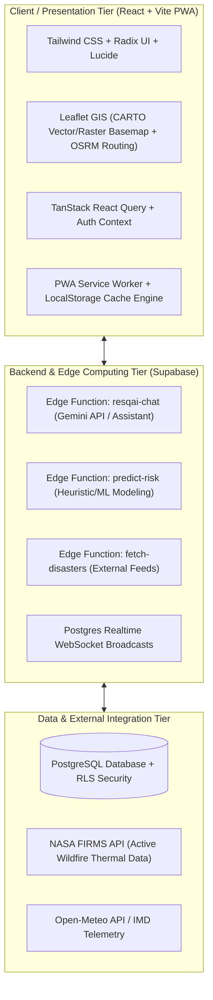

# ResQ AI: Intelligent Disaster Management & Crisis Response Platform
## College Minor Project — Comprehensive Presentation, Architecture & Viva Defense Guide

---

## 1. Project Synopsis & Executive Summary

### 1.1 Project Title
**ResQ AI:** An Edge-Resilient Geospatial Intelligence & Autonomous Crisis Response Platform for Disaster Management.

### 1.2 Core Problem Statement
During severe climatic and natural calamities (such as cyclones, flash floods, or forest fires):
1. **Communication Infrastructure Breakdown:** Cellular base stations, fiber lines, and internet backhauls frequently get damaged or congested, leaving victims without access to life-saving instructions or shelter routes.
2. **Fragmented Emergency Information:** Citizens, first responders, and emergency operation centers often rely on disjointed, lagged channels (social media rumors, unverified phone calls, static PDF advisories).
3. **Reactive Rather Than Proactive Response:** Traditional disaster response systems react *after* devastation occurs. There is a lack of localized predictive risk modeling and automated evacuation routing tailored to real-time safe zone capacity.

### 1.3 Proposed Solution
**ResQ AI** is a full-stack, offline-capable disaster intelligence platform that bridges citizens, emergency personnel, and central command:
- **Interactive Multi-Hazard Geospatial GIS:** High-performance mapping powered by CARTO dark basemaps with real-time incident heatmaps, NASA FIRMS active fire hotspots, and live hazard clusters.
- **Predictive Risk & Early Warning Engine:** Multi-parameter heuristic and ML forecasting across 6 primary disaster types (Cyclone, Flood, Wildfire, Earthquake, Landslide, Heat Wave).
- **Offline-First PWA & Edge Resilience:** Service worker precaching, local browser caching, and simulated mesh relay for critical advisories and offline predictions when cellular connectivity drops.
- **Autonomous Evacuation Planner & Shelter Optimization:** Automated shortest-path safe routing (via OSRM) connecting citizens to nearest disaster shelters with capacity tracking.
- **Unified Incident Command Room & Community Crowd-Validation:** Real-time reporting where incoming emergency claims undergo peer validation to filter rumors and prioritize first-responder dispatch.

---

## 2. System Architecture & Tech Stack

### Technical Specifications:
- **Frontend:** React 18, TypeScript, Vite, Tailwind CSS, Lucide Icons, Shadcn UI / Radix primitives.
- **Mapping & GIS:** Leaflet 1.9, React-Leaflet, Leaflet Routing Machine, OpenStreetMap/OSRM routing engines, CARTO dark tiles with authenticated API keys.
- **State Management & Caching:** `@tanstack/react-query` v5 with background stale-while-revalidate and optimistic UI updates.
- **Backend & Database:** Supabase (Cloud PostgreSQL with Row-Level Security, Realtime WebSockets, JWT Authentication).
- **Edge Computing & AI:** Deno-based Supabase Edge Functions with Google Gemini 1.5 Pro / Flash integration and offline heuristic fallback engines.
- **Resilience:** Vite PWA (`vite-plugin-pwa`), Workbox Service Workers, offline prediction serialization into `localStorage`.

---

## 3. Key Functional Modules (Walkthrough for Presentation)

### Module 1: Unified Command Center & Operational GIS Dashboard (`/dashboard`)
- **What to show Sir:** The full-screen geospatial dark map centering on high-risk disaster corridors (e.g., Coastal Odisha / Bay of Bengal basin).
- **Features:** 
  - Dynamic risk zones displaying hazard icons with animated pulse rings for Critical/High regions.
  - Slim activity rail on the left for one-click switching between **Predictions**, **Community Reports**, **Active Events**, **Live Weather**, **Shelters**, and **Real-Time Analytics**.
  - Interactive popup inspects: clicking any risk marker reveals multi-hazard probability bars, 48-hour forecast horizon, confidence score, and prescribed safety actions.

### Module 2: Multi-Hazard Risk Prediction Engine (`OfflinePredictionEngine` & `predict-risk`)
- **What to show Sir:** The Predictive Risk drawer in the sidebar.
- **Features:**
  - Evaluates geographical parameters: coastal proximity, river delta morphology, seasonal trends (monsoon flood, post-monsoon cyclone, summer wildfire/heatwave).
  - Server-Edge fallback: if server or network fails, the browser automatically switches to client-side heuristics and edge-cached models without showing a crash or blank screen.

### Module 3: Evacuation Planner & Dynamic Routing (`/evacuate`)
- **What to show Sir:** How a citizen finds an escape route.
- **Features:**
  - Automatically locates the user and calculates the nearest available emergency cyclone or flood shelter.
  - Renders live polyline turn-by-turn routing (Walking or Driving profiles) using OpenStreetMap / OSRM routing.
  - Interactive evacuation checklist (emergency medicines, documents, battery packs, water ration).

### Module 4: Incident Command Room & Community Crowd-Validation (`/control-room`)
- **What to show Sir:** How emergency authorities and citizens collaborate.
- **Features:**
  - Citizens log geo-tagged incidents with severity tags and descriptions.
  - Crowd-Validation: Peer citizens in the same grid can upvote/validate incidents, weeding out disinformation and fake emergency calls before dispatching NDRF / SDRF personnel.

### Module 5: Post-Disaster Recovery & Reconstruction Pipeline (`/post-disaster`)
- **What to show Sir:** The lifecycle of disaster management doesn't end with rescue; it covers rehabilitation.
- **Features:**
  - 5-stage recovery pipeline: `Assessment` -> `Relief` -> `Rehabilitation` -> `Reconstruction` -> `Completed`.
  - Analytical breakdown of infrastructure damage, funds allocated, and completion percentages.

---

## 4. How to Present to Your Professor / Evaluator

### 4.1 Recommended 3-Minute Elevator Pitch
> *"Good morning, Sir. Our minor project is **ResQ AI**, an edge-resilient disaster response and early warning platform designed to tackle the single biggest bottleneck during natural calamities: communication breakdown and fragmented crisis data.*
>
> *Unlike conventional disaster alert websites that fail when offline or only publish generic bulletins, ResQ AI operates as an offline-first Progressive Web App. It features an interactive Leaflet GIS map with live active wildfire and weather feeds, automated turn-by-turn shelter evacuation routing, a multi-hazard risk prediction engine, and a community crowd-validation portal for first responders.*
>
> *I would like to demonstrate how the system handles real-time risk predictions, offline fallbacks, and emergency evacuation routing."*

### 4.2 Step-by-Step Live Demo Flow
1. **Landing Page (`/`):** Point out the clean architecture, localized bilingual toggle (English, Hindi, Odia), and high-contrast dark theme designed for emergency low-light conditions.
2. **Dashboard (`/dashboard`):** Show the full-screen CARTO map. Toggle the collapsible side rail (e.g. click "Predictions"). Click any marker on the map to show the risk breakdown (Flood, Cyclone, Wildfire, Landslide).
3. **Evacuate (`/evacuate`):** Click the highlighted emergency "Evacuate" tab. Select a shelter (e.g. *Cuttack Indoor Stadium* or *Puri Temple Complex*) and demonstrate how the turn-by-turn route is drawn on the map.
4. **Control Room (`/control-room`):** Explain how first responders prioritize resources and how community crowd-validation verifies incidents.

---

## 5. Potential Viva & Defense Questions (with Model Answers)

### General & Conceptual Questions

#### Q1: Why did you choose Disaster Management for your minor project?
**Answer:**
> *"Natural disasters cause immense economic loss and loss of life primarily due to delayed evacuation and misinformation. Most existing government portals are static informational pages that cannot run offline and don't provide personalized turn-by-turn navigation to safe shelters. ResQ AI solves this by integrating GIS mapping, edge caching, and localized prediction into one unified system."*

#### Q2: What is the main USP (Unique Selling Proposition) of your project?
**Answer:**
> *"The key USP is **Offline & Edge Resilience**. If a user loses cellular connectivity during a cyclone, traditional apps fail completely. ResQ AI leverages a PWA Service Worker, browser-cached prediction models, and local heuristics so citizens can still view cached danger zones and shelter locations completely offline."*

---

### Technical & Architectural Questions

#### Q3: Why did you choose React + Vite over traditional server-rendered templates or plain HTML/JS?
**Answer:**
> *"Vite provides lightning-fast HMR and an optimized ES-module build pipeline with Rollup. React's component-based virtual DOM allows us to build dynamic real-time map overlays and collapsible dashboard drawers without full page reloads. Combined with `@vite-plugin-pwa`, Vite generates production-grade Service Workers that handle asset precaching automatically."*

#### Q4: How is the mapping implemented? Why Leaflet instead of Google Maps API?
**Answer:**
> *"Google Maps API requires proprietary billing per tile request and has strict restrictions on offline tile caching. We chose **Leaflet with CARTO basemaps and OpenStreetMap/OSRM**. This stack is open-source, lightweight, easily customizable with custom SVG/canvas radar layers, and supports free routing engines without expensive per-API-call billing."*

#### Q5: How do the Risk Predictions work? Is it real ML or heuristic?
**Answer:**
> *"We implemented a dual-tier architecture. In our Supabase Edge Function (`predict-risk`), we designed an ML integration stub that accepts multi-spectral weather and meteorological inputs (precipitation, wind speeds, sea surface temperature). When an external ML model endpoint is connected via `ML_MODEL_URL`, it invokes deep learning models. If offline or if the external endpoint is unreachable, our system seamlessly falls back to a deterministic multi-parameter heuristic model based on geospatial coordinates, coastal topography, and seasonal climatology. This guarantees zero downtime."*

#### Q6: How does the system ensure data security and prevent fake reports?
**Answer:**
> *"First, at the database level, Supabase PostgreSQL utilizes **Row-Level Security (RLS)** policies so anonymous users cannot tamper with core records. Second, for incident reporting, we implemented a **Community Crowd-Validation algorithm**: incidents submitted by the public start in a 'Pending Validation' state and require corroboration from local users before being elevated to 'Verified Emergency' status on the main command radar."*

#### Q7: What is the role of Supabase in your tech stack?
**Answer:**
> *"Supabase acts as our Backend-as-a-Service (BaaS). It provides an enterprise-grade PostgreSQL database, user authentication (JWTs), serverless Edge Functions running on Deno, and Postgres Realtime WebSockets, which push live incident updates to our map without requiring constant client polling."*

---

## 6. Future Scope & Enhancements (What to say when asked "What next?")
1. **LoRa / BLE Mesh Hardware Integration:** Connecting hardware LoRa radio modules via Web Bluetooth API for true smartphone-to-smartphone emergency communication over miles without cell towers.
2. **Satellite Synthetic Aperture Radar (SAR) Ingestion:** Ingesting live Sentinel-1 radar imagery to automatically segment flood-water inundation boundaries using computer vision.
3. **Automated WhatsApp / SMS Gateway Integration:** Sending compressed coordinate SMS fallback alerts for basic feature phones.
4. **Drone Fleet Dispatch API:** Providing automated waypoint JSON exports for emergency relief delivery drones.
